  
  
  

---

### About me

I'm a developer based in **Prague, Czech Republic**. I enjoy turning ideas into working products, from Python tools and browser games to full-stack web apps and native macOS utilities.

- 🔭 Currently building **[Astronow](https://astronow.mrpandayx.com)**, a space survival game with 1000 levels and 20 bosses
- 🍎 Working on a lightweight macOS menu bar manager in **Swift**
- 🌱 Deepening my backend skills (Python & TypeScript) on [Boot.dev](https://www.boot.dev/)
- 💬 Open to collaboration on web and game projects

### Tech stack

  

### Featured projects

| Project | Description | Stack |
| --- | --- | --- |
| 🚀 [**Astronow**](https://astronow.mrpandayx.com) | Space survival game: dodge asteroids, beat bosses, survive the levels | React · JavaScript |
| 🌐 [**Portfolio**](https://github.com/MrPandayx/MrPandayx.github.io) | Bilingual (EN/CZ) personal site, accessible and responsive | HTML · CSS · JS |
| 🎰 [**Slotmachine.py**](https://github.com/MrPandayx/Slotmachine.py) | Terminal slot machine with multi-language support | Python |

### GitHub stats

  
  

  

  

### Contribution snake

  <picture>
    <source media="(prefers-color-scheme: dark)" srcset="https://raw.githubusercontent.com/MrPandayx/MrPandayx/output/github-snake-dark.svg" />
    <source media="(prefers-color-scheme: light)" srcset="https://raw.githubusercontent.com/MrPandayx/MrPandayx/output/github-snake.svg" />
    
  </picture>

